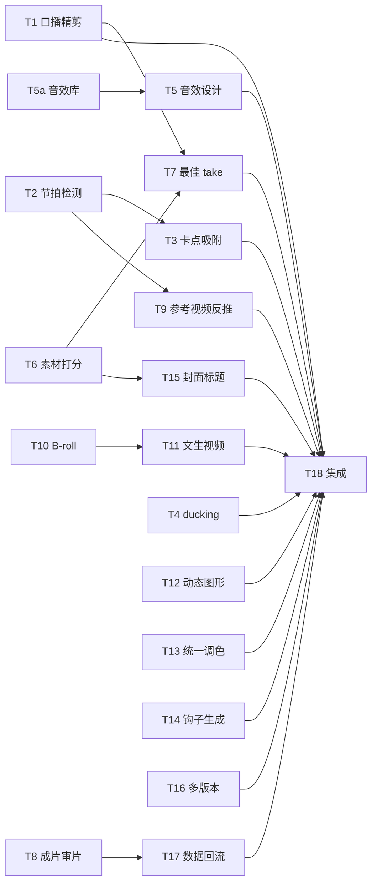

# 待办清单（高质量短片能力）

更新：2026-11-01（T1–T18 全部完成：9 个 agent 并行开发 T1–T17，主线完成 T18 集成）。状态：🔲 未开始 · 🚧 开发中 · ✅ 完成

目标：补齐"判断力"和"原材料"，让 skill 剪出的片子不只是版面正确，而是好看、好听、留得住人。

## 任务

| # | 功能 | 产物（新文件） | 依赖 | Agent | 状态 |
|---|---|---|---|---|---|
| T1 | 口播精剪：口癖（嗯/那个/就是说）、重复句、NG 片段只留最后一遍 | `scripts/speech_cleanup.py` | 转写（已有） | speech | ✅ |
| T2 | 音乐节拍检测：beat / onset / 强拍、段落能量 | `scripts/beat_detect.py` | — | beat | ✅ |
| T3 | 卡点吸附：切点吸附到鼓点，强拍放重要镜头 | `scripts/beat_snap.py` | T2 | beat | ✅ |
| T4 | 自动 ducking：人声段 BGM 压低 8–12 dB（音量关键帧） | `scripts/core/mix_ops.py` | — | audio | ✅ |
| T5a | 音效库索引：whoosh / pop / hit / riser 分类 | `data/sfx_library.csv` | — | audio | ✅ |
| T5 | 音效设计：事件 → 音效规则表，自动铺音效 | `scripts/sfx_designer.py` | T5a | audio | ✅ |
| T6 | 素材质量打分：模糊、抖动、曝光、人脸 / 眼神 | `scripts/shot_quality.py` | — | quality | ✅ |
| T7 | 最佳 take 挑选：同句多遍里选最好的一遍 | `scripts/best_take.py` | T1, T6 | take | ✅ |
| T8 | 成片质量审片：钩子强度、节奏曲线、死区、色调跳变、观众视角抽帧 | `scripts/quality_review.py` | — | review | ✅ |
| T9 | 参考视频结构反推 → scene / style JSON | `scripts/reference_analyzer.py` | T2 | reference | ✅ |
| T10 | B-roll 视频供给（Pexels / Pixabay video）+ 按旁白语义匹配 | `scripts/broll_fetch.py` | — | content | ✅ |
| T11 | 文生 / 图生视频 provider 接口（可灵 / 即梦 / Veo，先 mock） | `scripts/genvideo_providers.py` | T10（共用素材接口） | content | ✅ |
| T12 | 动态图形模板库：图表、数字滚动、箭头标注、地图路线 | `assets/motion_graphics/` + `scripts/motion_graphics.py` | web-vfx（已有） | visual | ✅ |
| T13 | 统一调色：按参考帧把所有镜头匹配到同一色调 | `scripts/color_match.py` | — | visual | ✅ |
| T14 | 剧本与钩子生成：多钩子版本、结构模板、金句 | `prompts/hook_writer.md` + `references/methodology/hook_bank.md` | — | content | ✅ |
| T15 | 封面与标题：候选帧 + 封面大字 + 多标题 | `scripts/cover_maker.py` | T6 | quality | ✅ |
| T16 | 多版本输出：15 / 30 / 60s、横竖屏 | `scripts/variants.py` | — | content | ✅ |
| T17 | 数据回流：完播率曲线 → 掉人点 → 规则修改建议 | `scripts/retention_feedback.py` | T8 | review | ✅ |
| T18 | 集成：SKILL.md 路由、rules、guided 流程、CI、CHANGELOG | — | 全部 | 主线 | ✅ |

## 依赖图

## 并行方案

- 第 1 波（同时开工，7 个 agent）：speech(T1) · beat(T2→T3) · audio(T4→T5a→T5) · quality(T6→T15) · review(T8→T17) · visual(T13, T12) · content(T10→T11, T14, T16)
- 第 2 波（依赖满足即开工）：reference(T9，等 beat) · take(T7，等 speech + quality)
- 第 3 步：主线集成 T18

文件所有权：每个 agent 只建自己的新文件 + `tests/test_<功能>.py` + `docs/features/<功能>.md`。
`SKILL.md`、`scripts/jy_wrapper.py`、`rules/*`、CI、`CHANGELOG.md`、`requirements.txt` 只在 T18 由主线改。
